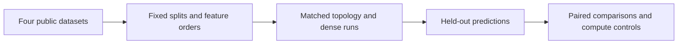

# Recursive Network Capacity Study

**Feras Elghandour**

Test whether balanced recursive topologies offer a useful accuracy or compute advantage over alternative trees and dense networks.

## Implementation

A predeclared four-dataset experiment with balanced, random, skewed, and dense models; feature-order controls; ten seeds; four capacity levels; and a supplementary corrected-compute comparison. Data preprocessing, per-run metrics, histories, and analysis are included.



## Evidence and results

The completed study contains **960 main runs plus 160 compute-control runs**. Balanced trees exceed random-tree mean accuracy in **14/16 native settings**, but exceed the corrected-compute dense baseline in only **5/16**. Dense models remain faster. Fresh release checks exactly reproduce one balanced run on each of four datasets, including checkpoints and held-out predictions.


## Run locally

Python 3.11 or later; use an isolated environment.

```sh
python -m pip install -r requirements.txt
python run_grid.py --self-check
python run_grid.py --verify results
python analyze_results.py --results results --compute-control compute_control
```

A complete new grid is available with `python run_grid.py --out new_results`, followed by `python run_compute_control.py --main new_results --out new_control`. This is a substantial CPU workload. Only the four representative checkpoints and prediction arrays required by `--verify` are bundled; all aggregate records and training histories are retained. [Protocol](PROTOCOL.md) and [measured results](MEASURED_RESULTS.md) document the study.

## Scope and limitations

This finite tabular study does not establish a universal scaling law or general topology advantage. Accuracy and timing depend on data, model budgets, feature order, and hardware. Four fresh representative reproductions do not mean all 1,120 runs were retrained for this release.

[Validation record](VALIDATION.md) · [Inputs and applicable notices](DATA.md)
