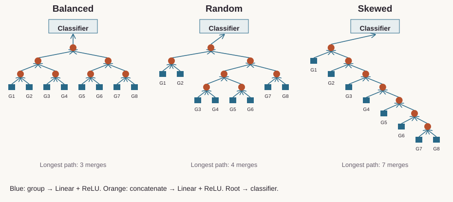
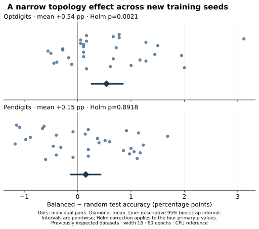
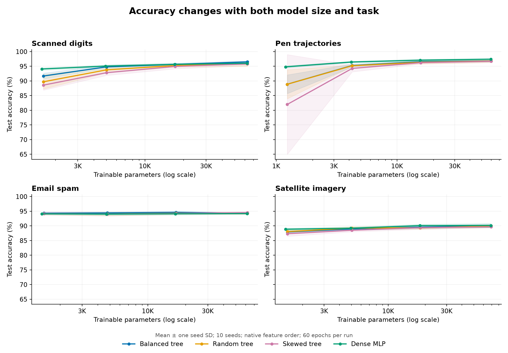

# Recursive Network Capacity Study

Test whether balanced recursive topologies offer a useful accuracy or compute advantage over alternative trees and dense networks.

**[Explore the results](https://feraselghandour.github.io/recursive-network-capacity-study/)** · [Experiment protocol](PROTOCOL.md) · [Operating scope](OPERATIONS.md)

## How the models work

Each feature group passes through its own Linear + ReLU block. Every merge concatenates two hidden vectors, applies another Linear + ReLU block, then passes its output toward a classifier. The tree variants change the merge path while retaining the same trainable block shapes.

<picture>
  <source media="(max-width: 760px)" srcset="assets/topology-comparison-mobile.svg">
  
</picture>

Schematics generated from [the implemented topology function](run_grid.py), seed 0. Eight groups are shown; group dimensions depend on the dataset. Satimage uses nine groups. The dense comparator is a separate two-hidden-layer MLP.

## Try a small training run

Use Python 3.11 or later. From a terminal:

```sh
git clone https://github.com/FerasElghandour/recursive-network-capacity-study.git
cd recursive-network-capacity-study
python -m venv .venv
. .venv/bin/activate
python -m pip install -r requirements.txt
python examples/train_toy.py
```

This runs the actual `Tree` implementation on 256 generated 16-feature samples, grouped into eight pairs. It trains all three topologies on CPU for 40 full-batch steps, from matching initial parameter values. No dataset download is needed.

Example output excerpt:

| Topology | Parameters | Maximum merge depth | Initial → final training loss |
|---|---:|---:|---:|
| Balanced | 1,162 | 3 | 0.7071 → 0.1559 |
| Random | 1,162 | 4 | 0.7075 → 0.1159 |
| Skewed | 1,162 | 7 | 0.7075 → 0.2067 |

These are demonstration outputs, **not held-out accuracy or evidence that one topology generalizes better**. They show the optimization path and parameter/depth distinction. [Complete example output](examples/train_toy-output.json) · [Example environment](examples/environment.json). Values may vary with dependency versions.

Change the training duration or seed with `python examples/train_toy.py --epochs 20 --seed 1`.

## New paired-seed follow-up

All **256 new training runs** completed across Optdigits and Pendigits, with 32 paired seeds, width 16 and native/permuted feature-order controls. Balanced trees improve mean native-order Optdigits accuracy by **0.54 percentage points** over random trees (Holm-adjusted p = 0.0021). Pendigits and both order interactions show no clear effect under the declared analysis.



This is a narrow follow-up on previously inspected datasets. All 256 trained models are included for replay; four representative retraining runs reproduced their weights exactly. [Results and limits](results/followup-v1/RESULTS.md) · [Frozen settings](FOLLOWUP_PROTOCOL.json).

```sh
python verify_followup.py --results results/followup-v1
python followup.py --out new-followup
```

## Study results

The recorded study contains **960 main runs plus 160 compute-control runs**, across four datasets, ten seeds and four capacity levels, with feature-order controls. Balanced trees exceed random-tree mean accuracy in **14/16 native settings**, but exceed the corrected-compute dense baseline in only **5/16**. Dense models remain faster.



Means and one seed standard deviation across ten seeds, native feature order. [Measured results](MEASURED_RESULTS.md) · [Interactive comparison](https://feraselghandour.github.io/recursive-network-capacity-study/).

## Reproduce the study

The toy example is separate from the recorded benchmark. To inspect or reproduce benchmark evidence after preparing the included inputs described in [DATA.md](DATA.md):

```sh
python run_grid.py --self-check
python run_grid.py --verify results
python analyze_results.py --results results --compute-control compute_control
```

The verification command retrains four representative balanced runs and compares checkpoints and held-out predictions. For the original grid, only those four checkpoints and prediction arrays are bundled; all aggregate records and training histories are retained. The separate new follow-up includes all 256 trained models.

For a complete new training grid:

```sh
python run_grid.py --out new_results
python run_compute_control.py --main new_results --out new_control
```

This is a substantial CPU workload. [Compute-control protocol](COMPUTE_CONTROL_PROTOCOL.md) · [Validation record](VALIDATION.md).

## Scope

This finite tabular study does not establish a universal scaling law or general topology advantage. Accuracy and timing depend on data, model budgets, feature order and hardware. Four representative reproductions do not mean all 1,120 recorded runs were retrained for this release. The new toy example does not modify those records.

Run `python build_report.py` to rebuild the hosted static explorer from the retained native-order summary. Full experiments run separately.

## Reuse

The original contributions listed in [LICENSING.md](LICENSING.md) are available under [MIT](LICENSE). This scoped grant preserves upstream notices and separate dataset, simulator, notebook and checkpoint terms.
